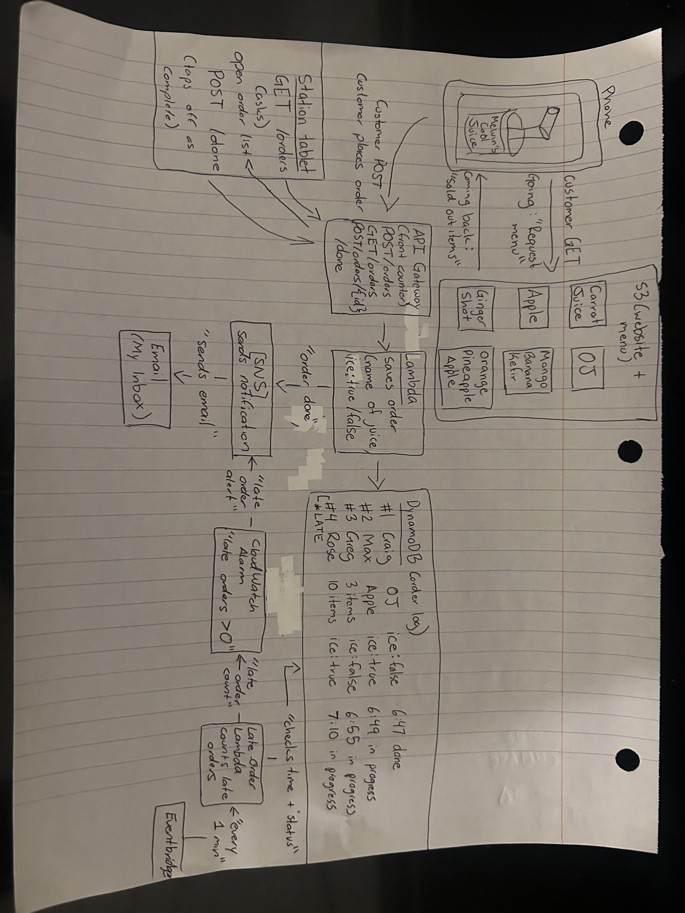

# 🧃 Melvin's Cool Juice — Serverless Ordering System on AWS

**Melvin Martinez Lorenzo** · CS 79C Final Project · Santa Monica College

A juice bar ordering system. Customers order from their phone and choose ice or no ice. A station tablet shows open orders, and staff tap them off when done. If an order runs late, the manager gets an email alert:

- **4 items or fewer** → late after **10 minutes**
- **5 items or more** → late after **20 minutes**

> **Status:** Deployed, tested, and **torn down** after capturing evidence (see [`evidence/`](evidence/)). The live URLs no longer work, on purpose, to avoid charges.

## Architecture

| Service | Role |
|---|---|
| **Amazon S3** | Hosts the customer app, station tablet page, and `menu.json` (with sold-out flags) |
| **API Gateway (HTTP API)** | The "front counter": `POST /orders`, `GET /orders`, `POST /orders/{id}/done`; HTTPS only, CORS limited to the website |
| **AWS Lambda (Order)** | Saves orders, lists open orders, marks orders done and publishes the notification |
| **Amazon DynamoDB** | The order log: order #, name, items (ice true/false), time placed, status |
| **Amazon SNS** | Emails for "order done" and late-order alarms |
| **Amazon EventBridge** | Runs the late-order check every minute |
| **AWS Lambda (Late-Check)** | Counts orders past their limit and sends the count to CloudWatch |
| **Amazon CloudWatch** | `LateOrders` metric + alarm (fires when > 0), plus Lambda logs |
| **AWS CloudFormation** | `template.yaml` creates the DynamoDB table, SNS topic, and email subscription |

Region: `us-west-1` (N. California). Both Lambdas run Python 3.12 on arm64.

## Repository layout

| Path | Contents |
|---|---|
| `template.yaml` | CloudFormation template (DynamoDB + SNS) |
| `lambda/` | Both Lambda functions and their least-privilege IAM policies |
| `Website/` | Customer app, station tablet, menu, styles, API config |
| `architecture.png` | Architecture diagram |
| `evidence/` | Screenshots proving the system ran |

## How to rebuild it

1. **CloudFormation:** create a stack from `template.yaml` and enter your email. Confirm the SNS subscription email.
2. **Order Lambda:** Python 3.12, arm64, code from `lambda/order_handler.py`, handler `lambda_function.lambda_handler`. Environment variables `TABLE_NAME`, `TOPIC_ARN`, `BUILT_BY`. Attach `lambda/orders-policy.json` as an inline policy. Timeout 10 sec.
3. **API Gateway:** HTTP API with routes `POST /orders`, `GET /orders`, and `POST /orders/{id}/done`, all pointing to the Order Lambda. CORS origin set to the S3 website URL.
4. **Late-Check Lambda:** Python 3.12, arm64, code from `lambda/late_check.py`, environment variable `TABLE_NAME`, inline policy `lambda/late-check-policy.json`. Add an EventBridge trigger with `rate(1 minute)`.
5. **CloudWatch alarm:** metric `MelvinsCoolJuice / LateOrders`, Maximum, 1 minute, `> 0`, missing data treated as good. Notify the SNS topic on **In alarm** and **OK**.
6. **S3:** create a bucket with static website hosting (`index.html`) and a public-read bucket policy. Put the API URL in `Website/config.js`, then upload the 5 files in `Website/`.

## Teardown

All resources were deleted after testing: the CloudWatch alarm, EventBridge rule, both Lambdas, the API, the CloudFormation stack (DynamoDB + SNS), the S3 bucket, the IAM roles, and the log groups.
